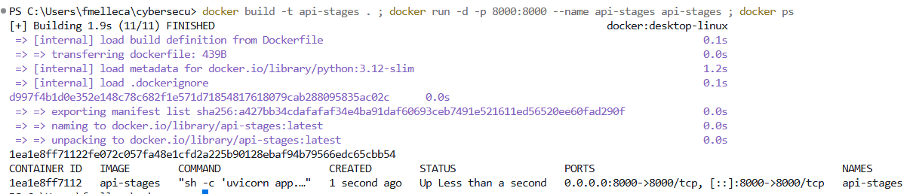
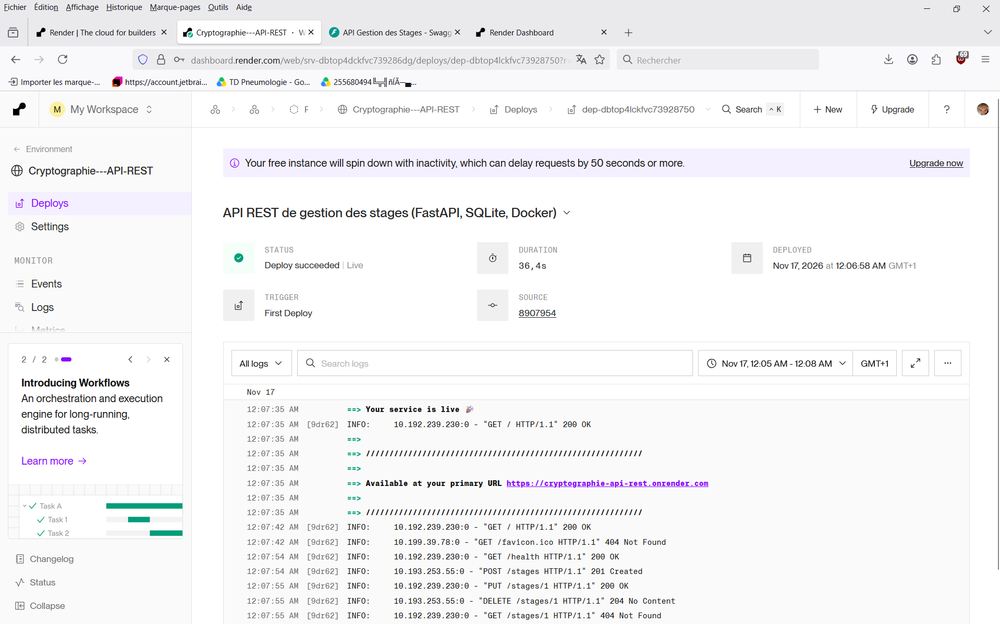
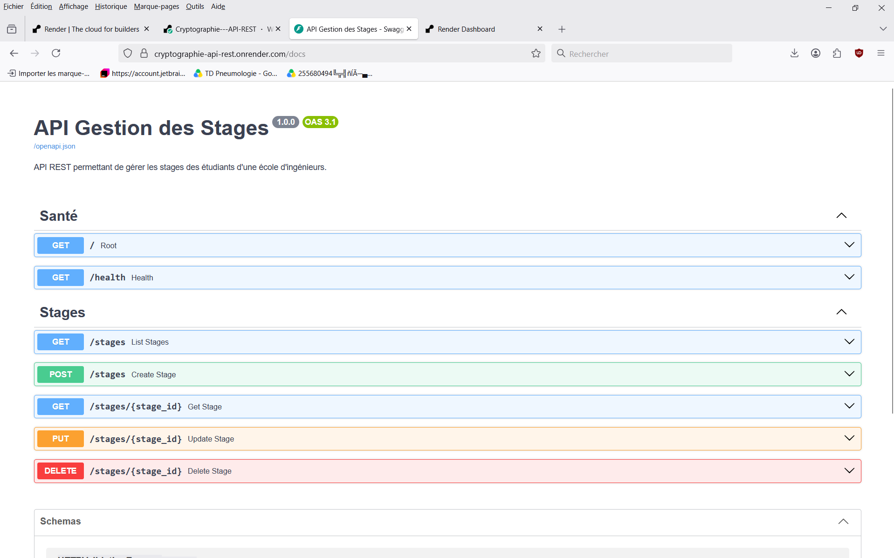
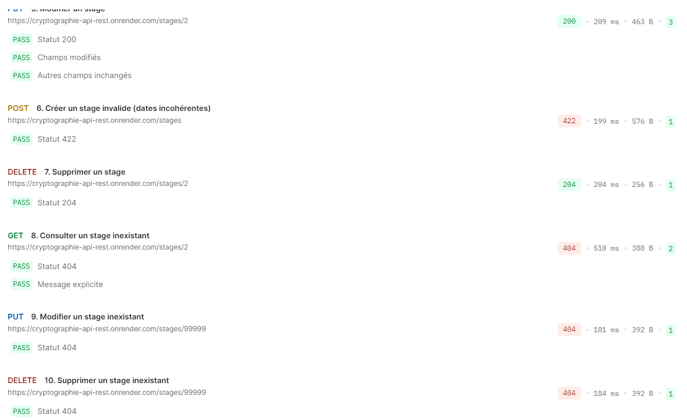

# API Gestion des Stages

Mini-projet *Cloud Computing, Microservices et API* : API REST de gestion des stages
développée avec **FastAPI** et **SQLite**, conteneurisée avec **Docker** et déployée sur **Render**.

- **URL publique** : https://cryptographie-api-rest.onrender.com
- **Documentation Swagger** : https://cryptographie-api-rest.onrender.com/docs — ReDoc : https://cryptographie-api-rest.onrender.com/redoc

> Plan gratuit Render : après une période d'inactivité, le premier appel peut prendre ~1 minute (réveil du service).

## Modèle de données

| Champ          | Type          | Description               |
|----------------|---------------|---------------------------|
| `id`           | int (auto)    | Identifiant               |
| `nom_etudiant` | string        | Nom de l'étudiant         |
| `entreprise`   | string        | Entreprise d'accueil      |
| `intitule`     | string        | Intitulé du stage         |
| `date_debut`   | date (`YYYY-MM-DD`) | Date de début       |
| `date_fin`     | date (`YYYY-MM-DD`) | Date de fin (≥ début) |

## Endpoints

| Méthode | Route              | Description                                   | Codes retour      |
|---------|--------------------|-----------------------------------------------|-------------------|
| GET     | `/`                | Message d'accueil                              | 200               |
| GET     | `/health`          | État du service                                | 200               |
| GET     | `/stages`          | Liste des stages (`?entreprise=` pour filtrer) | 200               |
| GET     | `/stages/{id}`     | Détail d'un stage                              | 200, 404          |
| POST    | `/stages`          | Création d'un stage                            | 201, 422          |
| PUT     | `/stages/{id}`     | Modification (champs partiels acceptés)        | 200, 404, 422     |
| DELETE  | `/stages/{id}`     | Suppression                                    | 204, 404          |

- **404** : le stage demandé n'existe pas → `{"detail": "Stage 42 introuvable"}`
- **422** : données invalides (champ manquant, date mal formée, `date_fin` < `date_debut`)

### Exemple de requête

```bash
curl -X POST http://localhost:8000/stages \
  -H "Content-Type: application/json" \
  -d '{"nom_etudiant":"Alice Martin","entreprise":"Airbus","intitule":"Développeur Backend","date_debut":"2026-02-01","date_fin":"2026-07-31"}'
```

## Lancer en local

```bash
python -m venv .venv
source .venv/bin/activate        # Windows : .venv\Scripts\activate
pip install -r requirements.txt
uvicorn app.main:app --reload
```

Swagger : http://localhost:8000/docs

### Tests automatisés

```bash
pip install pytest httpx
pytest -q
```

Couvrent : création, liste, consultation, modification, suppression, stage inexistant (404) et validation (422).

### Tests Postman

Importer `postman/API-Stages.postman_collection.json` dans Postman, puis lancer la collection
(**Run collection**). La variable de collection `baseUrl` vaut `http://localhost:8000` ;
la remplacer par `https://cryptographie-api-rest.onrender.com` pour tester l'API déployée.

## Docker

```bash
docker build -t api-stages .
docker run -d -p 8000:8000 --name api-stages api-stages
curl http://localhost:8000/health
```

Puis ouvrir http://localhost:8000/docs.

## Déploiement sur Render

1. Pousser le projet sur GitHub.
2. Sur https://render.com : **New → Web Service** → connecter le dépôt.
3. Environnement : **Docker**, plan : **Free**.
4. Lancer le déploiement (Render injecte la variable `PORT`, prise en compte par le Dockerfile).
5. Récupérer l'URL publique (ici https://cryptographie-api-rest.onrender.com) et tester `/docs`.

> ⚠️ Sur le plan gratuit, le service se met en veille après inactivité (premier appel lent)
> et la base SQLite est réinitialisée à chaque redémarrage / redéploiement.

## Captures d'écran

### Conteneurisation Docker (build, run, `docker ps`)


### Déploiement Render (service Live, logs)


### Documentation Swagger accessible publiquement


### Tests Postman sur l'API déployée (18 tests réussis, 0 échec)



## Structure

```
.
├── app/
│   └── main.py          # API FastAPI + accès SQLite
├── tests/
│   └── test_api.py      # Tests pytest
├── postman/             # Collection Postman
├── captures/            # Captures d'écran
├── Dockerfile
├── requirements.txt
└── README.md
```
