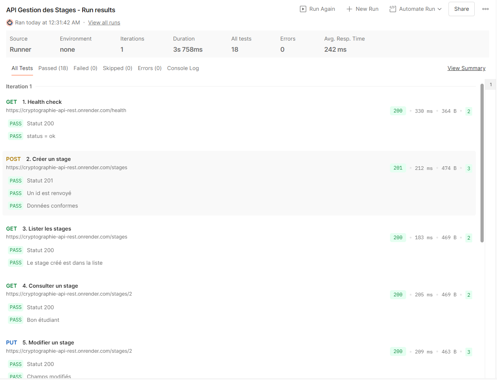

# API Gestion des Stages

Mini-projet *Cloud Computing, Microservices et API* : API REST de gestion des stages
développée avec **FastAPI** et **SQLite**, conteneurisée avec **Docker** et déployée sur **Render**.

- **URL publique** : https://cryptographie-api-rest.onrender.com
- **Documentation Swagger** : https://cryptographie-api-rest.onrender.com/docs — ReDoc : https://cryptographie-api-rest.onrender.com/redoc

> Plan gratuit Render : après une période d'inactivité, le premier appel peut prendre ~1 minute (réveil du service).

## Modèle de données

| Champ          | Type          | Description               |
|----------------|---------------|---------------------------|
| `id`           | int (auto)    | Identifiant               |
| `nom_etudiant` | string        | Nom de l'étudiant         |
| `entreprise`   | string        | Entreprise d'accueil      |
| `intitule`     | string        | Intitulé du stage         |
| `date_debut`   | date (`YYYY-MM-DD`) | Date de début       |
| `date_fin`     | date (`YYYY-MM-DD`) | Date de fin (≥ début) |

## Endpoints

| Méthode | Route              | Description                                   | Codes retour      |
|---------|--------------------|-----------------------------------------------|-------------------|
| GET     | `/`                | Message d'accueil                              | 200               |
| GET     | `/health`          | État du service                                | 200               |
| GET     | `/stages`          | Liste des stages (`?entreprise=` pour filtrer) | 200               |
| GET     | `/stages/{id}`     | Détail d'un stage                              | 200, 404          |
| POST    | `/stages`          | Création d'un stage                            | 201, 422          |
| PUT     | `/stages/{id}`     | Modification (champs partiels acceptés)        | 200, 404, 422     |
| DELETE  | `/stages/{id}`     | Suppression                                    | 204, 404          |

- **404** : le stage demandé n'existe pas → `{"detail": "Stage 42 introuvable"}`
- **422** : données invalides (champ manquant, date mal formée, `date_fin` < `date_debut`)

### Exemple de requête

Le plus simple, sur tous les systèmes : ouvrir le Swagger (`/docs`) et utiliser **Try it out**.

Linux / macOS (bash) :

```bash
curl -X POST http://localhost:8000/stages \
  -H "Content-Type: application/json" \
  -d '{"nom_etudiant":"Alice Martin","entreprise":"Airbus","intitule":"Développeur Backend","date_debut":"2026-02-01","date_fin":"2026-07-31"}'
```

Windows (PowerShell) — `curl` y est un alias d'une autre commande, on utilise donc `Invoke-RestMethod` :

```powershell
Invoke-RestMethod -Method Post -Uri http://localhost:8000/stages -ContentType "application/json" -Body '{"nom_etudiant":"Alice Martin","entreprise":"Airbus","intitule":"Developpeur Backend","date_debut":"2026-02-01","date_fin":"2026-07-31"}'
```

## Lancer en local

Prérequis : **Python 3.10 à 3.14** (testé avec 3.12 et 3.14).

Linux / macOS :

```bash
python3 -m venv .venv
source .venv/bin/activate
pip install -r requirements.txt
uvicorn app.main:app --reload
```

Windows (PowerShell) :

```powershell
python -m venv .venv
.venv\Scripts\Activate.ps1
pip install -r requirements.txt
uvicorn app.main:app --reload
```

> Si PowerShell refuse d'exécuter `Activate.ps1` (« l'exécution de scripts est désactivée »),
> lancer d'abord `Set-ExecutionPolicy -Scope Process -ExecutionPolicy Bypass` (valable pour la fenêtre en cours uniquement).

Swagger : http://localhost:8000/docs

### Tests automatisés

```bash
pip install -r requirements-dev.txt
pytest -q
```

Le fichier `pytest.ini` ajoute la racine du projet au chemin Python : `pytest -q` fonctionne directement,
sans erreur `No module named 'app'`.

Couvrent : création, liste, consultation, modification, suppression, stage inexistant (404) et validation (422).

### Tests Postman

Importer `postman/API-Stages.postman_collection.json` dans Postman, puis lancer la collection
(**Run collection**). La variable de collection `baseUrl` vaut `http://localhost:8000` ;
la remplacer par `https://cryptographie-api-rest.onrender.com` pour tester l'API déployée.

## Docker

```bash
docker build -t api-stages .
docker run -d -p 8000:8000 --name api-stages api-stages
```

Puis ouvrir http://localhost:8000/health et http://localhost:8000/docs dans un navigateur.

Pour relancer après une modification, supprimer d'abord l'ancien conteneur (sinon `docker run` échoue car le nom `api-stages` est déjà pris) :

```bash
docker rm -f api-stages
docker build -t api-stages .
docker run -d -p 8000:8000 --name api-stages api-stages
```

Pour simplement redémarrer un conteneur arrêté (ex. après un redémarrage de Docker Desktop) : `docker start api-stages`.

## Déploiement sur Render

1. Pousser le projet sur GitHub.
2. Sur https://render.com : **New → Web Service** → connecter le dépôt.
3. Environnement : **Docker**, plan : **Free**.
4. Lancer le déploiement (Render injecte la variable `PORT`, prise en compte par le Dockerfile).
5. Récupérer l'URL publique (ici https://cryptographie-api-rest.onrender.com) et tester `/docs`.

> ⚠️ Sur le plan gratuit, le service se met en veille après inactivité (premier appel lent)
> et la base SQLite est réinitialisée à chaque redémarrage / redéploiement.

## Captures d'écran

### Conteneurisation Docker (build, run, `docker ps`)


### Déploiement Render (service Live, logs)


### Documentation Swagger accessible publiquement


### Tests Postman sur l'API déployée (18 tests réussis, 0 échec)



## Structure

```
.
├── app/
│   └── main.py          # API FastAPI + accès SQLite
├── tests/
│   └── test_api.py      # Tests pytest
├── postman/             # Collection Postman
├── captures/            # Captures d'écran
├── Dockerfile
├── pytest.ini
├── requirements.txt     # Dépendances de l'API
├── requirements-dev.txt # + pytest, httpx pour les tests
└── README.md
```
